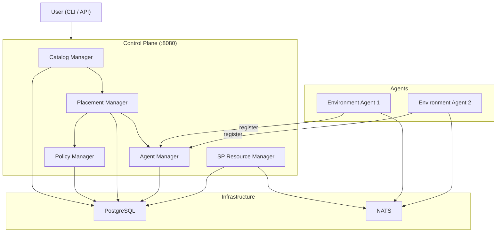
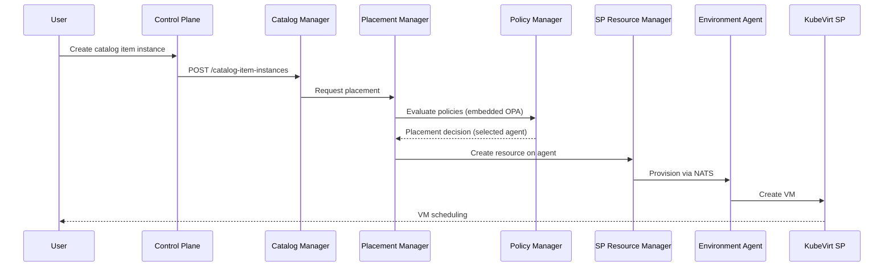

DCM (Data Center Management) is a control plane for managing infrastructure
services across multiple environment agents. This page gives a high-level
overview of how the components fit together.

## Components

## Component Responsibilities

| Component               | Role                                                                                                                                                                       |
| ----------------------- | -------------------------------------------------------------------------------------------------------------------------------------------------------------------------- |
| **Control Plane**       | Single process that exposes all DCM APIs on `:8080`. Hosts the catalog, policy, placement, agent, and SP resource managers in one binary.                                  |
| **Catalog Manager**     | Manages service types, catalog items, and catalog item instances. Triggers placement when an instance is created.                                                          |
| **Policy Manager**      | Stores placement policies (Rego) and evaluates them via an embedded OPA engine.                                                                                            |
| **Placement Manager**   | Selects an environment agent for a new instance by evaluating policies against available agents.                                                                           |
| **Agent Manager**       | Tracks registered environment agents and their health status.                                                                                                              |
| **SP Resource Manager** | Manages the lifecycle of resources on service providers through environment agents.                                                                                        |
| **PostgreSQL**          | Persistent storage for the control plane.                                                                                                                                  |
| **NATS**                | Message bus for communication between the SP Resource Manager and environment agents.                                                                                      |
| **Environment Agents**  | Agents that bridge the control plane and service providers (e.g., KubeVirt). They register with the control plane and manage the actual resources (VMs, containers, etc.). |

## Request Flow

When a user creates a catalog item instance, the following happens:

1. The **Catalog Manager** receives the request and asks the **Placement
   Manager** to find a suitable agent.
2. The **Placement Manager** evaluates placement policies through the **Policy
   Manager**, which uses an embedded OPA engine to evaluate Rego.
3. Once an agent is selected, the resource is created through the **SP Resource
   Manager**, which sends the request to the **environment agent** via NATS. The
   agent provisions the resource on the underlying service provider.
