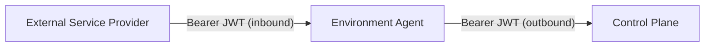

The [environment agent](https://github.com/dcm-project/environment-agent) runs
in a target environment and acts as the intermediary between the DCM control
plane and the Service Providers (SPs) deployed there. It has **two independent**
authentication surfaces, separate from the control-plane authentication covered
in [Authentication](../authentication/):

1. **Inbound** — protecting the agent's own REST API (external SP registration,
   provider listing) from unauthenticated callers.
2. **Outbound** — authenticating the agent's own requests to the control plane
   (agent registration and heartbeat) when the control plane has authentication
   enabled.

Both use the same mechanism as the control plane: OIDC-issued JWT bearer tokens,
validated with [Keycloak](https://www.keycloak.org/) in the reference stack. You
can enable either one independently of the other.



## Inbound: protecting the agent's API

The agent's REST API — external SP registration (`POST /api/v1alpha1/providers`)
and provider listing (`GET /api/v1alpha1/providers`,
`GET /api/v1alpha1/providers/{provider_id}`) — can require a valid JWT bearer
token on every request. This closes the gap called out in the
[environment agent enhancement](https://github.com/dcm-project/enhancements/blob/main/enhancements/environment-agent/environment-agent.md#authentication-and-authorization-for-sp-registration-consolidation):
external SP registration was previously unauthenticated, with network isolation
as the only interim mitigation.

Only `GET /api/v1alpha1/health` stays public. The bypass checks both the method
and exact path, so `GET /health` and every other method or path require a token.

### How it works

1. At startup, the agent discovers OIDC metadata from the issuer. When it
   validates a token, it fetches signing keys from the issuer's JWKS endpoint as
   needed and caches them.
2. On each protected request, the agent extracts the
   `Authorization: Bearer <token>` header (case-insensitive scheme) and
   validates signature, expiry, issuer, and — if configured — audience.
3. On success, the token's `sub` and `preferred_username` claims are attached to
   the request's audit log line. There is no actor store or suspension concept
   on the agent side (unlike the control plane): a valid token is sufficient to
   call the API.
4. On failure, the agent returns `401 Unauthorized` as an RFC 7807 problem
   response with a `WWW-Authenticate: Bearer` header. The response body never
   contains the underlying validator error (for example "token expired" or
   "signature invalid") — only a fixed `invalid Bearer token` detail. The
   specific reason is logged server-side only.

### Configuration

| Variable                  | Purpose                                                                                                                                                                                                                |
| ------------------------- | ---------------------------------------------------------------------------------------------------------------------------------------------------------------------------------------------------------------------- |
| `AGENT_AUTH_DISABLED`     | When `true` (the default), auth middleware is bypassed. The agent still logs a startup `WARN` ("authentication is disabled") so the insecure default is visible in logs.                                               |
| `AGENT_AUTH_ISSUER_URL`   | OIDC issuer URL for JWT validation (for example `http://keycloak:8080/realms/dcm`). Required when `AGENT_AUTH_DISABLED=false`; startup fails otherwise.                                                                |
| `AGENT_AUTH_JWT_AUDIENCE` | Expected `aud` claim. Empty (the default) **disables audience validation** — any token from the issuer is accepted regardless of `aud`. The agent logs a startup `WARN` if an issuer is set but the audience is empty. |

This mirrors the control plane's `AUTH_DISABLED` / `AUTH_ISSUER_URL` /
`AUTH_JWT_AUDIENCE` variables (see
[Control-plane configuration](../authentication/#control-plane-configuration)),
but with an `AGENT_` prefix and its own env vars — the two services are
configured independently, even when pointed at the same Keycloak realm.

> **Set an audience before production.** When `AGENT_AUTH_JWT_AUDIENCE` is
> empty, the agent skips audience validation: any otherwise-valid token from the
> configured issuer is accepted, regardless of its `aud` claim. For production,
> configure a dedicated audience and add it to tokens from every authorized SP
> client with an audience mapper. Leave the audience empty only for local
> development while configuring those mappers.

### Calling the agent API with a bearer token

Set `SP_TOKEN` to an access token issued by the same issuer configured in
`AGENT_AUTH_ISSUER_URL`, using the flow provisioned for the calling SP. For
background on obtaining issuer-issued tokens, see
[Obtaining and using tokens](../authentication/#obtaining-and-using-tokens). If
`AGENT_AUTH_JWT_AUDIENCE` is set, the token's `aud` claim must include that
value; configure the issuer or caller client to add the matching audience.

```bash
curl -s \
  -H "Authorization: Bearer ${SP_TOKEN}" \
  -H "Content-Type: application/json" \
  -d '{"name":"db-provider","endpoint":"https://sp.example.com:8080","service_type":"database","schema_version":"v1alpha1"}' \
  http://localhost:8081/api/v1alpha1/providers
```

Without a valid token (auth enabled), this returns `401 Unauthorized`:

```json
{
  "type": "UNAUTHORIZED",
  "title": "Unauthorized",
  "status": 401,
  "detail": "invalid Bearer token",
  "instance": "/api/v1alpha1/providers"
}
```

`GET /api/v1alpha1/health` always succeeds without a token:

```bash
curl -s http://localhost:8081/api/v1alpha1/health
```

## Outbound: agent-to-control-plane authentication

When the control plane has authentication enabled (see
[Authentication](../authentication/)), the agent's own registration
(`POST /api/v1alpha1/agents`) and heartbeat
(`PUT /api/v1alpha1/agents/{agent_id}/heartbeat`) calls must carry a valid
bearer token too. Three modes are supported, resolved at startup:

1. **OAuth2 client credentials** (recommended for production) — the agent
   fetches short-lived JWTs from an OIDC token endpoint and refreshes them
   automatically before they expire.
2. **Static token** (dev / simple deployments) — a single pre-obtained JWT is
   sent as-is on every request, with no refresh.
3. **No auth** (default, backward-compatible) — neither is configured, so no
   `Authorization` header is sent. This is required for the unauthenticated
   local-setup flow described in
   [Local Setup](../local-setup/#verifying-the-deployment).

If more than one mode is configured, **client credentials takes precedence over
the static token**.

### Configuration

| Variable                  | Mode               | Purpose                                                                                            |
| ------------------------- | ------------------ | -------------------------------------------------------------------------------------------------- |
| `DCM_AUTH_TOKEN_ENDPOINT` | Client credentials | OIDC token endpoint (for example `http://keycloak:8080/realms/dcm/protocol/openid-connect/token`). |
| `DCM_AUTH_CLIENT_ID`      | Client credentials | OAuth2 client ID for the agent's service account.                                                  |
| `DCM_AUTH_CLIENT_SECRET`  | Client credentials | OAuth2 client secret.                                                                              |
| `DCM_AUTH_TOKEN`          | Static token       | A pre-obtained JWT sent unchanged on every request.                                                |

All three client-credentials variables must be set together — a partial
configuration (for example an endpoint without a client ID) is a **startup-fatal
error** that names the missing variables. `DCM_AUTH_TOKEN_ENDPOINT` must also be
an absolute, host-qualified `http(s)://` URL.

> **Caution:** `http://` token endpoints send the client secret unencrypted on
> every token request. The agent logs a startup warning in this case; prefer
> `https://` outside local development. The agent also refuses to follow any
> redirect returned by the token endpoint, so the secret is never resent to a
> different origin.

### Token handling

- Client-credentials tokens are cached in memory and refreshed proactively — 10
  seconds before the `expires_in` deadline from the token response, not
  reactively on a `401`.
- A token fetch failure does **not** crash the agent. Registration and
  re-registration retry transient failures with exponential backoff
  (`DCM_REGISTRATION_INITIAL_BACKOFF` / `DCM_REGISTRATION_MAX_BACKOFF`). A
  failed heartbeat is logged and retried on the next heartbeat tick, controlled
  by `AGENT_HEARTBEAT_INTERVAL` (30 seconds by default); heartbeat failures do
  not use the registration backoff.
- **Static tokens do not refresh.** Once the token expires, the control plane
  returns `401`, which the agent treats as non-retryable — registration halts
  until the agent is restarted with a fresh token. Use static tokens only where
  the token's lifetime safely exceeds the agent's expected uptime.

### Keycloak setup

The reference Keycloak realm includes the confidential `dcm-proxy` client, with
service accounts enabled and a `dcm-api` audience mapper. The reference Compose
and Helm setups reuse the `dcm-proxy` client secret as `AUTH_PROXY_SECRET`; the
control plane accepts that secret in `X-Auth-Proxy-Secret` requests and trusts
the accompanying forwarded identity headers. Someone who obtains the agent's
environment can use the shared secret with a forged `X-Forwarded-User` value to
act as any resolvable actor. Keep this shared-secret setup local to development.
In production, use a dedicated Keycloak client for the agent, with a client
secret independent from `AUTH_PROXY_SECRET`, and configure the deployment to
inject that secret as `DCM_AUTH_CLIENT_SECRET`. The reference Helm chart
currently sources `DCM_AUTH_CLIENT_SECRET` from the `AUTH_PROXY_SECRET` key, so
it needs separate secret wiring before using this production setup.

To configure a dedicated client, enable **Client authentication** and **Service
accounts roles**, then set the three `DCM_AUTH_*` variables to that client's
token endpoint and credentials. The control plane currently requires an
authenticated actor context for agent registration; the registration endpoint
does not check for a particular Keycloak role.

> **Audience mapper for custom clients:** If the control plane enforces
> `AUTH_JWT_AUDIENCE=dcm-api`, a new client must include `dcm-api` in its
> token's `aud` claim. Add an audience mapper to that client. The reference
> `dcm-proxy` client already has this mapper, so it does not need additional
> configuration.

### Kubernetes secrets

Store the client secret in a Kubernetes `Secret` and inject it with `envFrom`
rather than embedding it in a pod spec or `ConfigMap`:

```yaml
envFrom:
  - secretRef:
      name: environment-agent-auth
```

## Troubleshooting

| Symptom                                                                    | Things to check                                                                                                                                                                                                                                                                    |
| -------------------------------------------------------------------------- | ---------------------------------------------------------------------------------------------------------------------------------------------------------------------------------------------------------------------------------------------------------------------------------- |
| SP registration returns `401` from the agent                               | Auth enabled on the agent (`AGENT_AUTH_DISABLED=false`); the SP's token is valid and not expired; issuer matches `AGENT_AUTH_ISSUER_URL`; if `AGENT_AUTH_JWT_AUDIENCE` is set, the token's `aud` must match.                                                                       |
| Agent registration/heartbeat to the control plane returns `401`            | Check the `DCM_AUTH_*` client credentials and token endpoint, then verify that the token issuer and (when enabled) audience match the control plane's `AUTH_*` settings. Add a `dcm-api` mapper for a custom client if required; the reference `dcm-proxy` client already has one. |
| Agent fails to start with `AGENT_AUTH_ISSUER_URL: required...`             | `AGENT_AUTH_DISABLED=false` but no issuer was set — set `AGENT_AUTH_ISSUER_URL` or leave auth disabled.                                                                                                                                                                            |
| Agent fails to start with a "partial client-credentials auth config" error | Only some of `DCM_AUTH_TOKEN_ENDPOINT` / `DCM_AUTH_CLIENT_ID` / `DCM_AUTH_CLIENT_SECRET` are set — set all three or none.                                                                                                                                                          |
| Registration halts permanently after working for a while                   | Static `DCM_AUTH_TOKEN` expired (no refresh) — switch to client credentials, or restart the agent with a fresh token.                                                                                                                                                              |
| `AGENT_AUTH_JWT_AUDIENCE` startup warning                                  | Expected when an issuer is set without an audience — informational unless you intended to enforce `aud`.                                                                                                                                                                           |

For control-plane-side issuer, JWKS, and Keycloak troubleshooting, see
[Authentication troubleshooting](../authentication/#troubleshooting).
